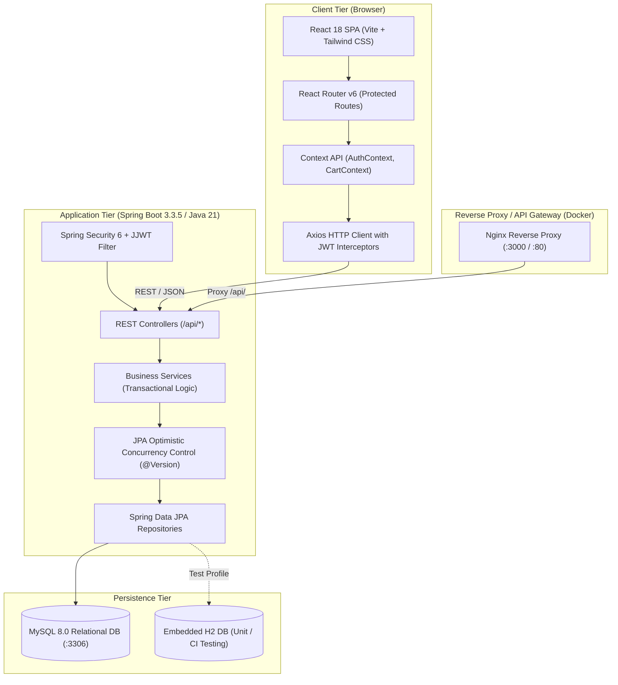

# Online Grocery Ordering System

A centralized, full-stack, enterprise-grade web application for online grocery shopping engineered and verified against the 21-page Software Requirements Specification (SRS).

The system enables **Customers** to browse, search, and purchase groceries with real-time stock verification via **Cash on Delivery (COD)**, provides **Vendors** with dedicated portals to manage product listings, inventory levels, and order fulfillment, and empowers **System Administrators** with full operational oversight over user accounts, vendor approvals, and platform analytics.

---

## 🏛️ System Architecture



---

## 📋 SRS Requirements Traceability Matrix

| SRS Requirement | Functional Module | Implementation Details |
|---|---|---|
| **FR1: Authentication & RBAC** | Identity & Access | Stateless JJWT bearer tokens, BCrypt password hashing, deactivated user rejection on authentication and request filtering, public customer registration and vendor application submission (pending approval), and role enforcement for `CUSTOMER`, `VENDOR`, and `ADMIN`. |
| **FR2: Catalog Browse & Search** | Products & Discovery | Full-text name/description filtering, category filtration, vendor-specific product isolation, property-whitelisted sorting, and server-side pagination. |
| **FR3: Shopping Cart Management** | Cart Operations | Real-time stock ceiling validation, line-item quantity stepper controls, zero-quantity auto-removal, cart clearing, and live total calculations. |
| **FR4: Order Placement** | Checkout & Inventory | Atomic transactional checkout, strict delivery address capture, automatic inventory decrement, and shopping cart reset. Exclusively uses **Cash on Delivery (COD)** per SRS specification. |
| **FR5: Order Status & Cancellation** | Order Lifecycle | Linear status progression (`PENDING` &rarr; `CONFIRMED` &rarr; `SHIPPED` &rarr; `DELIVERED`). Customer cancellation for `PENDING` orders and Vendor rejection with transactional stock restoration. Prohibits cancellation of fulfilled orders. |
| **FR6 & FR7: Vendor Catalog & Stock** | Vendor Portal | Dedicated dashboard for product creation, SKU updates, soft deletion, and inline stock replenishment. Optimistic locking (`@Version`) prevents race conditions during concurrent stock updates. |
| **FR8: Profile Management** | User Account | Self-service profile updates (name, email, phone, delivery address) and BCrypt-secured password updates with previous password validation. |
| **FR9: Notification System** | Alerts & Updates | Event-driven in-app notifications generated upon order placement (vendor notification) and status transitions (customer notification). |
| **FR10: Administrative Governance** | Admin Portal | System-wide user directory audit, account activation/deactivation (soft delete preserving order history), and vendor onboarding and approval workflows. |
| **Analytics & Reporting** | Dashboard | Platform metrics: revenue, order status distribution, SKU counts, and low-stock warnings (&lt;10 units). |

---

## 🛠️ Technology Stack

- **Frontend:**
  - **Framework:** React 18 with Vite
  - **Styling:** Tailwind CSS with Lucide React icons
  - **HTTP & State:** Axios (with dynamic bearer token interceptors), React Context API
  - **Routing:** React Router v6 with strict Role-Based Route Guards (`ProtectedRoute`)
  - **Testing:** Node.js native test runner (`node:test`, `node:assert`)
- **Backend:**
  - **Framework:** Spring Boot 3.3.5 on Java 17/21+ (verified on OpenJDK 26)
  - **Security:** Spring Security 6, JJWT 0.12.6, BCryptPasswordEncoder
  - **Persistence:** Spring Data JPA, Hibernate ORM 6.5, HikariCP
  - **Validation & Docs:** Hibernate Validator / Jakarta Validation 3.0, Springdoc OpenAPI 2.6.0 (Swagger UI)
  - **Testing:** JUnit 5, Mockito, AssertJ, Embedded H2 in MySQL Compatibility Mode
- **Database:**
  - MySQL 8.0+ Relational Database
- **DevOps & Containerization:**
  - Multi-stage Dockerfiles (Eclipse Temurin JRE, Nginx Alpine)
  - Docker Compose multi-tier orchestration

---

## 👥 Optional Demo Accounts

When the application starts with a new or empty database, `DataInitializer` creates demo accounts only when the required passwords are provided through environment variables. If these variables are missing or blank, demo account creation is skipped.

The following demo accounts are available when the corresponding seed passwords are configured:

| Role | Email | Password Source | Details / Assigned Permissions |
|---|---|---|---|
| **ADMIN** | `admin@grocery.com` | `${SEED_ADMIN_PASSWORD}` | System Administrator — full access to user management, vendor onboarding, and analytics. |
| **VENDOR** | `freshfarms@grocery.com` | `${SEED_VENDOR1_PASSWORD}` or `${SEED_VENDOR_PASSWORD}` | *Fresh Farms Organics* — manages Fruits, Vegetables, and Dairy. |
| **VENDOR** | `greenvalley@grocery.com` | `${SEED_VENDOR2_PASSWORD}` or `${SEED_VENDOR_PASSWORD}` | *Green Valley Produce* — manages Bakery, Pantry, and Beverages. |
| **CUSTOMER** | `customer@grocery.com` | `${SEED_CUSTOMER_PASSWORD}` | Active Shopper with saved address and order history. |

> **Interactive Demo Tip:** For local testing, configure passwords in your `.env` file (see `.env.example`). The frontend Login screen contains 1-click quick-fill buttons for Admin, Vendor, and Customer to facilitate rapid testing and client demonstrations.

---

## 🔒 Security & Quality Enhancements

1. **Zero Hardcoded Credentials:**
   - Database credentials, JWT secrets, and token expiry parameters are strictly externalized via environment variables.
   - Safe `.env.example` template provided; all `.env` files are ignored in `.gitignore`.
2. **Account Deactivation Enforcement:**
   - Soft-deleted / inactive accounts are blocked during authentication (`AuthService`) and prevented from executing authorized API requests via `JwtAuthenticationFilter` (`userDetails.isEnabled()`).
3. **Environment-Configurable CORS:**
   - Parameterized via `app.cors.allowed-origins` (`http://localhost:5173` default in dev, exact domain required in prod; wildcard origins disallowed).
4. **Optimistic Concurrency Locking:**
   - `@Version private Long version` on `Product` entities prevents race conditions and inventory drift when multiple customers purchase the same SKU simultaneously.
5. **Linear Order Progression & Transactional Stock Restoration:**
   - Vendors must follow `PENDING` &rarr; `CONFIRMED` &rarr; `SHIPPED` &rarr; `DELIVERED`.
   - Customer cancellations (restricted to `PENDING` orders) and vendor rejections transactionally restore SKU stock levels in a single atomic database transaction (`@Transactional`).
6. **Sort Whitelist & SQL Injection Prevention:**
   - Parameter whitelisting on catalog sort fields (`name`, `price`, `createdAt`, `stock`, `category`) protects query generation.

---

## 🚀 Getting Started

### Prerequisites
- **Java:** JDK 17, 21, or newer (tested on Java 21 and OpenJDK 26)
- **Maven:** Maven 3.9+ (or use the pre-configured project runner in `.tools/maven`)
- **Node.js:** Node 18 or 20+ (with npm 9+)
- **MySQL:** MySQL Server 8.0+ running locally (or via Docker Compose)
- **Git**

---

### Database Setup & Automated Provisioning

1. **MySQL 8.0+ Service:**
   - Ensure your MySQL server is running on `localhost:3306` (or set `DB_HOST` / `DB_PORT` in your `.env` file).
2. **Zero-Touch Schema Generation:**
   - No manual SQL scripts, migrations, or database creation commands are required.
   - The Spring Boot JDBC URL is pre-configured with `createDatabaseIfNotExist=true`. If the `online_grocery_db` database does not exist, MySQL creates it automatically on the first connection.
   - Hibernate ORM with `spring.jpa.hibernate.ddl-auto=update` inspects all entity definitions (`User`, `Vendor`, `Product`, `Order`, `OrderItem`, `CartItem`, `Notification`) and automatically creates all tables, foreign keys, indexes, and unique constraints.
   - *Production Note:* In production environments, set `spring.jpa.hibernate.ddl-auto=validate` and manage schema changes via a dedicated database migration tool (e.g. Flyway or Liquibase).
3. **Optional Demo Account Seeding:**
   - Demo accounts are created only when the required seed password environment variables are configured.
   - If the passwords are not configured, demo account creation is skipped.
   - The application includes 13 pre-stocked grocery products across its configured categories.

---

### Step 1: Environment Setup

Copy `.env.example` to `.env` in the project root:

```bash
cp .env.example .env
```

Review or modify your `.env` configuration:

```ini
# Database Configuration
DB_HOST=localhost
DB_PORT=3306
DB_NAME=online_grocery_db
DB_USERNAME=root
DB_PASSWORD=your_secure_password

# JWT Security (256-bit Base64-encoded secret key)
# Generate with: openssl rand -base64 32
JWT_SECRET=replace_with_base64_256bit_secret_key_minimum_32_bytes==
JWT_EXPIRATION_MS=86400000

# CORS Configuration
CORS_ALLOWED_ORIGINS=http://localhost:5173,http://localhost:3000

# Demo Account Seeding (Optional - leave unset to skip demo seeding)
SEED_ADMIN_PASSWORD=your_secure_admin_password_here
SEED_CUSTOMER_PASSWORD=your_secure_customer_password_here
SEED_VENDOR_PASSWORD=your_secure_vendor_password_here
```

---

### Step 2: Running the Spring Boot Backend

1. Navigate to the backend directory:
   ```bash
   cd backend
   ```
2. Build and launch with Maven:
   ```bash
   mvn spring-boot:run
   ```
   Or run the pre-built JAR:
   ```bash
   java -jar target/online-grocery-backend-1.0.0.jar
   ```
3. The REST API will be listening on `http://localhost:8080`:
   - **Swagger UI Documentation:** [http://localhost:8080/swagger-ui.html](http://localhost:8080/swagger-ui.html)
   - **OpenAPI JSON Spec:** [http://localhost:8080/api-docs](http://localhost:8080/api-docs)

---

### Step 3: Running the React Frontend

1. In a separate terminal, navigate to the frontend directory:
   ```bash
   cd frontend
   ```
2. Install dependencies (if not already installed):
   ```bash
   npm install
   ```
3. Start the Vite development server:
   ```bash
   npm run dev
   ```
4. Open your browser and navigate to [http://localhost:5173](http://localhost:5173).

---

### Step 4: Running with Docker Compose

To orchestrate the full multi-container stack (MySQL 8 + Spring Boot API + React Nginx SPA) in one command:

```bash
docker compose up --build
```

- **Frontend Application:** [http://localhost:3000](http://localhost:3000)
- **Backend API:** [http://localhost:8080](http://localhost:8080)
- **MySQL Database:** `localhost:3307` (container port 3306 mapped to host 3307)

---

## 🧪 Automated Testing

The project includes automated test suites for both backend and frontend layers:

### Backend Test Suite (JUnit 5 + Mockito + H2)
Runs 66 automated tests verifying authentication, JWT signing and claim validation, RBAC authorization, secure environment-driven data initialization, vendor registration & approval, cart management, optimistic locking, inventory decrement, order lifecycle transitions, and vendor isolation:

```bash
cd backend
mvn test
```
*Result: 66 tests executed, 0 failures, 0 errors.*

### Frontend Test Suite (Node Native Runner)
Runs 17 automated tests verifying RBAC route access rules, unapproved vendor guards, cart subtotal calculations, catalog sort whitelist mapping, order state transitions, and form validation constraints:

```bash
cd frontend
npm test
```
*Result: 17 tests executed, 0 failures, 0 errors.*

### Frontend Production Build Verification
```bash
cd frontend
npm run build
```
*Result: Vite production bundle built successfully without compilation errors.*

---

## 📡 REST API Reference

| Method | Endpoint | Access | Description |
|---|---|---|---|
| `POST` | `/api/auth/register` | Public | Customer registration with validation |
| `POST` | `/api/auth/register-vendor` | Public | Vendor partner application (pending admin approval) |
| `POST` | `/api/auth/login` | Public | Authenticate user & return JWT token |
| `GET` | `/api/auth/me` | Authenticated | Validate current JWT and return user session |
| `GET` | `/api/products` | Public | Paginated product search, filter, and sort |
| `GET` | `/api/products/{id}` | Public | Retrieve single product details |
| `GET` | `/api/products/categories` | Public | List all distinct categories |
| `GET` | `/api/products/vendors` | Public | List vendors for catalog filtering |
| `GET` | `/api/cart` | `CUSTOMER`, `ADMIN` | Retrieve current user's shopping cart |
| `POST` | `/api/cart` | `CUSTOMER`, `ADMIN` | Add product to cart with stock validation |
| `PUT` | `/api/cart/{id}?quantity={qty}` | `CUSTOMER`, `ADMIN` | Update cart item quantity |
| `DELETE` | `/api/cart/{id}` | `CUSTOMER`, `ADMIN` | Remove item from cart |
| `DELETE` | `/api/cart` | `CUSTOMER`, `ADMIN` | Clear all items from cart |
| `POST` | `/api/orders` | `CUSTOMER`, `ADMIN` | Place order (COD) and decrement inventory |
| `GET` | `/api/orders/my-orders` | `CUSTOMER`, `ADMIN` | View order history for current customer |
| `GET` | `/api/orders/{id}` | `CUSTOMER`, `ADMIN` | View order details |
| `PATCH` | `/api/orders/{id}/cancel` | `CUSTOMER`, `ADMIN` | Cancel pending order & restore inventory |
| `GET` | `/api/vendor/products` | `VENDOR`, `ADMIN` | List products owned by vendor |
| `POST` | `/api/vendor/products` | `VENDOR`, `ADMIN` | Create new product listing |
| `PUT` | `/api/vendor/products/{id}` | `VENDOR`, `ADMIN` | Update vendor product details |
| `DELETE` | `/api/vendor/products/{id}` | `VENDOR`, `ADMIN` | Soft-delete product listing |
| `PATCH` | `/api/vendor/products/{id}/stock` | `VENDOR`, `ADMIN` | Quick inline stock adjustment |
| `GET` | `/api/vendor/orders` | `VENDOR`, `ADMIN` | View orders containing vendor products |
| `PATCH` | `/api/vendor/orders/{id}/status` | `VENDOR`, `ADMIN` | Transition order status (`PENDING` &rarr; `CONFIRMED` &rarr; `SHIPPED` &rarr; `DELIVERED`) |
| `PATCH` | `/api/vendor/orders/{id}/cancel` | `VENDOR`, `ADMIN` | Reject/cancel pending order & restore inventory |
| `GET` | `/api/vendor/dashboard` | `VENDOR`, `ADMIN` | Vendor KPIs, revenue, and order metrics |
| `GET` | `/api/admin/users` | `ADMIN` | List all registered users |
| `PATCH` | `/api/admin/users/{id}/toggle-status` | `ADMIN` | Toggle user active / inactive status |
| `DELETE` | `/api/admin/users/{id}` | `ADMIN` | Deactivate user account |
| `POST` | `/api/admin/vendors` | `ADMIN` | Register & approve new vendor account |
| `GET` | `/api/admin/vendors` | `ADMIN` | List all registered vendors |
| `PATCH` | `/api/admin/vendors/{id}/toggle-status` | `ADMIN` | Approve, suspend, or reactivate vendor |
| `GET` | `/api/admin/orders` | `ADMIN` | Audit all marketplace orders |
| `GET` | `/api/admin/dashboard` | `ADMIN` | System-wide reporting dashboard KPIs & metrics |
| `GET` | `/api/notifications` | Authenticated | Retrieve user notifications |
| `GET` | `/api/notifications/unread-count` | Authenticated | Count unread notifications |
| `PATCH` | `/api/notifications/{id}/read` | Authenticated | Mark notification as read |
| `PATCH` | `/api/notifications/read-all` | Authenticated | Mark all notifications as read |
| `GET` | `/api/users/profile` | Authenticated | Retrieve personal profile details |
| `PUT` | `/api/users/profile` | Authenticated | Update user profile information |
| `POST` | `/api/users/change-password` | Authenticated | Update password with old password verification |

---

## 📌 Scope & Architectural Boundaries

In strict accordance with the SRS specification:
- **Payment Method:** The platform operates exclusively on **Cash on Delivery (COD)**. No third-party or paid payment gateway integrations are used.
- **Resource Ownership:** Vendors can only view and mutate their own inventory and orders. Customers can only view and manage their own carts and orders.
- **Audit Preservation:** User deactivation preserves customer orders and transaction histories for historical reporting.

---

## 🔍 Manual Testing & Verification Checklist

When performing manual browser validation:

1. **Authentication & Public Registration:**
   - Go to `http://localhost:5173/register`.
   - Test **Customer Registration**: Register a new customer (`testcustomer@example.com` / `Password@123`). Verify automatic login and redirect to the home catalog.
   - Test **Vendor Partner Application**: Switch to the **Vendor Partner** tab. Submit an application. Verify the confirmation screen indicating the account is pending administrator approval.
   - Attempt login with the new vendor account. Confirm the user-friendly notification: *"Your vendor account is pending administrator approval."*
2. **Administrator Governance & Vendor Approval:**
   - Configure `SEED_ADMIN_PASSWORD` in your `.env` file and use the corresponding password to log in as Admin (`admin@grocery.com`).
   - Navigate to **Admin &rarr; Vendors**. Verify the newly registered vendor appears with a **Pending / Suspended** badge.
   - Click **Approve Vendor**. Verify badge updates to **Active**.
   - Log out and log in with the newly approved vendor credentials. Confirm access to Vendor Dashboard and Product Management.
3. **Product Catalog & Browsing:**
   - Browse the 13 products across pages.
   - Filter by categories (Fruits, Vegetables, Dairy, Bakery, Pantry, Beverages).
   - Filter by vendor and test search by product name.
   - Sort by Price (Low to High / High to Low) and Newest First (`createdAt`).
4. **Cart & Cash on Delivery Checkout:**
   - Add items to cart; adjust quantities using `+` and `-`. Confirm stock ceiling prevention.
   - Proceed to **Checkout**. Enter delivery address and phone number.
   - Complete order with Cash on Delivery (COD). Verify inventory automatically decrements and cart is cleared.
5. **Order Lifecycle & Stock Restoration:**
   - In **Customer &rarr; Orders**, verify the new order is in `PENDING` status.
   - Test Customer cancellation on a `PENDING` order. Confirm status updates to `CANCELLED` and stock is automatically restored.
   - Place another order, log in as Vendor, and step through `CONFIRMED` &rarr; `SHIPPED` &rarr; `DELIVERED`. Verify customers can no longer cancel after status advances past `PENDING`.
